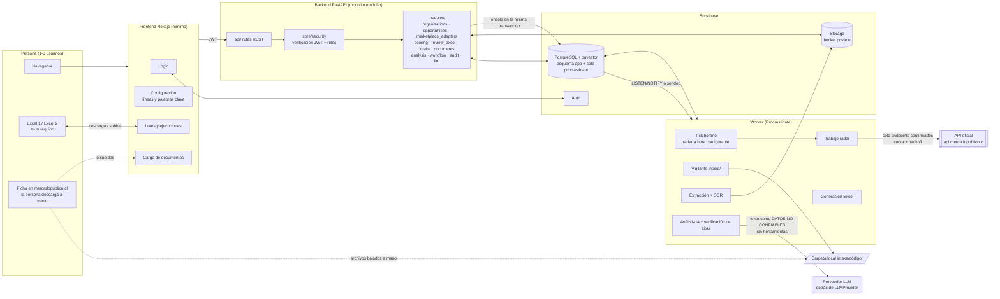
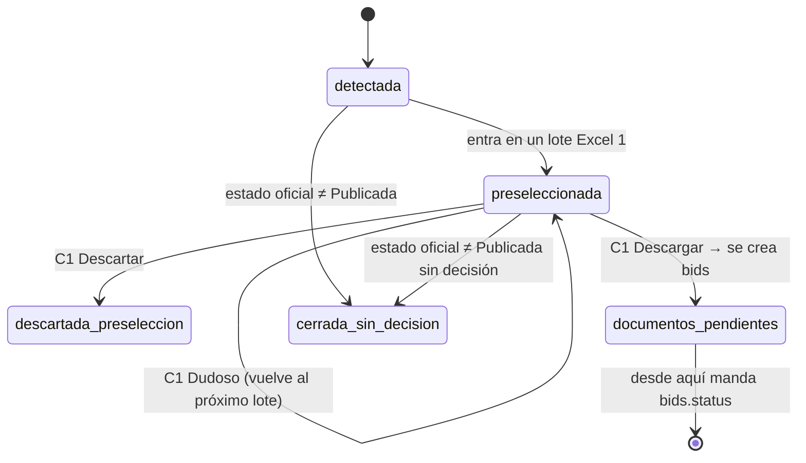
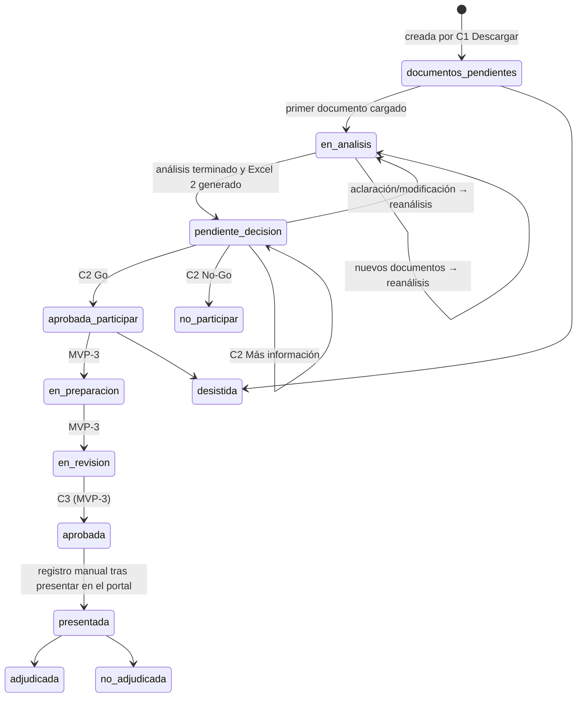

# 02 · Arquitectura

Estado: **APROBADO con cambios** (21-11-2026): filtros duros y selección del lote en el flujo (§2), estado del embudo
en `opportunities` y postulación desde "Descargar" (§3, ADR-0006), backend en el equipo del propietario (ADR-0008).

Monolito modular en Python (FastAPI) con un worker asíncrono que comparte el mismo código, PostgreSQL gestionado (Supabase)
como base y como cola de trabajos, y un frontend Next.js mínimo. Base: `01-decisiones-tecnicas.md`.

## 1. Diagrama de componentes



Reglas estructurales:
- `marketplace_adapters/mp_v1` solo traduce la API oficial a un **modelo canónico interno**; no contiene reglas de negocio.
  Cuando ChileCompra publique la API unificada se agrega `mp_v2` sin tocar el resto.
- `llm/` es la única puerta al proveedor de IA; el resto del código recibe objetos Pydantic validados.
- Ningún componente accede al portal `mercadopublico.cl`. Del portal solo se **construye** el link a la ficha.
- El ticket de la API se descifra solo dentro del adaptador, en memoria, y nunca se registra en logs.

## 2. Flujo del MVP (secciones 5.1 y 7 del brief) con las 3 compuertas humanas

```mermaid
flowchart TD
    A[1. Captura<br/>radar programado: listado diario liviano] --> B[2. Normalización y deduplicación<br/>por código oficial]
    B --> C{¿Código nuevo y<br/>CodigoEstado=Publicada?<br/>ADR-0010}
    C -->|sí| D[Detalle completo por código<br/>nombre, descripción, ítems, comprador, monto]
    C -->|no, pero conocida y<br/>cambió estado/FechaCierre| D
    C -->|no, sin cambios| Z1[Solo se actualiza estado oficial<br/>desde el listado, sin detalle]
    D --> E[3. Clasificación por línea de servicio<br/>reglas + IA opcional, sobre el detalle completo] --> F[Puntaje 0-100 en backend<br/>con explicación por factor]
    F --> FD{Filtros duros<br/>estado oficial Publicada<br/>y cierre ≥ 3 días desde la corrida}
    FD -->|no cumple| Z0[Queda detectada<br/>fuera del Excel]
    FD -->|cumple| SEL[Selección del lote<br/>50 de mayor puntaje + todas con puntaje ≥ 40]
    SEL --> G[Excel 1 de preselección<br/>lote + versión + hoja _control]

    G --> H{{"COMPUERTA 1 · Preselección<br/>persona marca Descargar / Descartar / Dudoso"}}
    H -->|Descartar| Z2[descartada en preselección<br/>motivo registrado]
    H -->|Dudoso| G
    H -->|Descargar| I[Importación validada<br/>crea la postulación bids<br/>+ intake/código/ + registro pendiente]

    I --> J[5. Obtención asistida<br/>la persona baja las bases desde la ficha<br/>y las deja en la carpeta o las sube]
    J --> K[Validación, hash, versión, auditoría]
    K --> L[Persona marca 'carga completa']
    L --> M[6. Extracción de texto y tablas + OCR]
    M --> N[Análisis IA → JSON validado]
    N --> O[Verificación determinística de citas<br/>No encontrado / No verificado]
    O --> P[Excel 2 de fichas resumen<br/>consolidado + detalle por licitación]

    P --> Q{{"COMPUERTA 2 · Go / No-Go<br/>persona revisa, corrige y decide"}}
    Q -->|No-Go| Z3[no participar<br/>motivo registrado]
    Q -->|Más información| P
    Q -->|Go| R[aprobada para participar<br/>se habilita preparación]

    R -.-> S[9. Preparación: checklist, matriz,<br/>borrador DOCX · MVP-3]
    S -.-> T{{"COMPUERTA 3 · Aprobación y presentación<br/>persona autorizada aprueba precio y contenido<br/>y presenta EN EL PORTAL, a mano"}}
    T -.-> V[12. Seguimiento: aclaraciones,<br/>modificaciones, resultado]

    W[Aclaración o modificación de bases<br/>o cambio de estado/fecha en la API] -.->|requiere reanálisis| M

    classDef gate fill:#fff3b0,stroke:#b08900,color:#000;
    classDef mvp3 stroke-dasharray: 5 5;
    class H,Q,T gate;
    class S,T,V mvp3;
```



Lo punteado es MVP-3 (fuera de alcance actual). Reglas que el backend hace cumplir (no solo la UI):
- Sin decisión "Descargar" registrada en la Compuerta 1 no existe postulación (`bids`) y la oportunidad **no acepta
  documentos** (HTTP 409).
- Sin presupuesto de IA disponible en el mes no se inician análisis (quedan `bloqueado_presupuesto`).
- Sin "carga completa" no se encola análisis.
- Sin decisión Go en la Compuerta 2 **no se crea preparación** (MVP-3).
- Ninguna transición presenta, firma ni envía nada a Mercado Público.

## 3. Estados internos (ADR-0006)

Tres campos distintos, ninguno se deduce del otro:
- **Estado oficial** de Mercado Público: `opportunities.official_status_code` / `official_status_text`
  (5 Publicada, 6 Cerrada, 7 Desierta, 8 Adjudicada, 18 Revocada, 19 Suspendida — a reconfirmar en `/p2-api`).
- **Estado interno del embudo** de la oportunidad: `opportunities.internal_status`, hasta la Compuerta 1.
- **Estado de la postulación**: `bids.status`, solo existe desde que la Compuerta 1 decide "Descargar".

### 3.1 Embudo de la oportunidad (`opportunities.internal_status`)



`documentos_pendientes` es el estado final del embudo de la oportunidad: significa "pasó a postulación". A partir de ese
momento el avance se lee en `bids.status`. Las vistas y el Excel muestran un **estado vigente** = `bids.status` si existe
postulación; si no, `opportunities.internal_status`.

### 3.2 Postulación (`bids.status`)



Ambas máquinas de estados viven en `modules/workflow`; toda transición queda en `audit_events` con usuario, origen
(UI, importación de Excel, sistema) y estado anterior/nuevo.

## 4. Secuencia del radar programado

Estrategia de detalle, ritmo, ventana de ejecución y estimación de duración: **ADR-0010** (decisión del propietario
tras `/p2-api`). Resumen: se pide el detalle completo de toda licitación de código nuevo en estado Publicada, y de
toda licitación conocida cuyo `CodigoEstado` o `FechaCierre` cambió en el listado (ambos vienen sin costo de cuota);
nunca se usa el título como pre-filtro, porque el listado no trae rubro y descartaría candidatas válidas.

```mermaid
sequenceDiagram
    autonumber
    participant S as Tick horario (worker)
    participant R as Trabajo radar
    participant Q as Control de cuota
    participant A as Adaptador mp_v1
    participant M as API Mercado Público
    participant DB as PostgreSQL
    S->>DB: ¿hora local en ventana configurada (01:00-05:00 Chile, ADR-0010) y sin corrida OK hoy?
    S->>R: encola radar(fecha_radar) con bloqueo único
    R->>DB: crea radar_runs (iniciada)
    R->>Q: reserva 1 solicitud
    R->>A: listado diario (GET licitaciones.json?fecha=ddmmaaaa, confirmado en /p2-api, docs/10)
    A->>M: GET con ticket (solo en memoria)
    M-->>A: listado (solo CodigoExterno, Nombre, CodigoEstado, FechaCierre)
    A-->>R: lista canónica + api_call_log
    R->>DB: upsert por código oficial; compara CodigoEstado/FechaCierre contra lo guardado; registra cambios en opportunity_changes
    loop códigos nuevos en Publicada, o conocidos con cambio de estado/FechaCierre (ADR-0010)
        R->>Q: reserva 1 solicitud (ritmo configurable, default 1 cada 2s)
        R->>A: detalle por código
        A->>M: GET
        M-->>A: detalle completo (nombre, descripción, ítems/rubro, comprador, monto, fechas)
        R->>DB: normaliza fechas (UTC + texto original, fechas centinela ≤1950 → missing), comprador, ítems
    end
    R->>DB: clasificación + puntaje sobre el detalle completo (opportunities, opportunity_service_lines)
    R->>DB: cierra radar_runs con conteos, consumo de cuota y errores
```

Errores: 429/5xx → backoff exponencial (2s, 4s, 8s..., máx. N intentos; `/p2-api` observó un 429 real incluso
respetando 1 req/s, así que es comportamiento esperable, no excepcional), luego la candidata queda `detail_pending`
y se reintenta en la siguiente corrida; nunca se pierde lo ya guardado. Si se alcanza el límite diario configurado
(por defecto 8.000 de 10.000, contado por día calendario de Chile), la corrida termina como "parcial". Estados de
licitación no documentados por ChileCompra (se observaron `15` y `16` junto a los 6 conocidos) se guardan con el
código y texto crudos (`official_status_text`), se marcan como "estado no documentado" y se registra una alerta en
el log — nunca hacen fallar la corrida.

## 5. Seguridad transversal

- Secretos solo en `.env` (local) o variables del host (prod). El ticket de API además cifrado en `api_credentials`.
- Filtro de `structlog` que elimina `ticket=` de URLs y cabeceras de autorización antes de escribir.
- Archivos subidos: lista blanca de extensiones, tipo real, tamaño máximo, ZIP con límites (cantidad, tamaño total,
  razón de compresión, rutas con `..` o absolutas), Excel sin macros.
- Prompts: instrucciones del sistema fijas y versionadas; el contenido de documentos va entre delimitadores como
  **DATOS NO CONFIABLES**; el modelo no tiene herramientas; la salida se valida contra esquema y cualquier campo fuera
  de esquema se descarta.
- Auditoría (`audit_events`) de: login, cambios de configuración, corridas, exportación/importación de Excel, cargas,
  análisis, decisiones y transiciones de estado.
